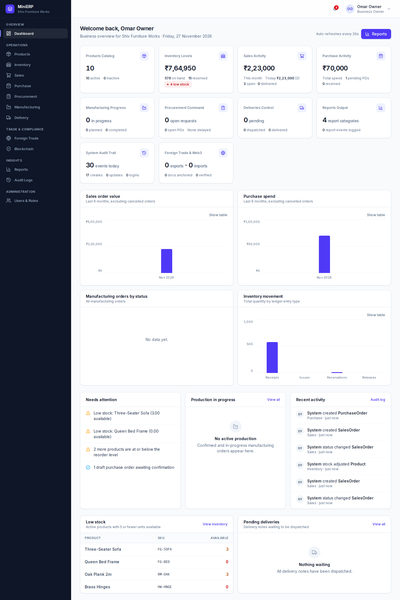
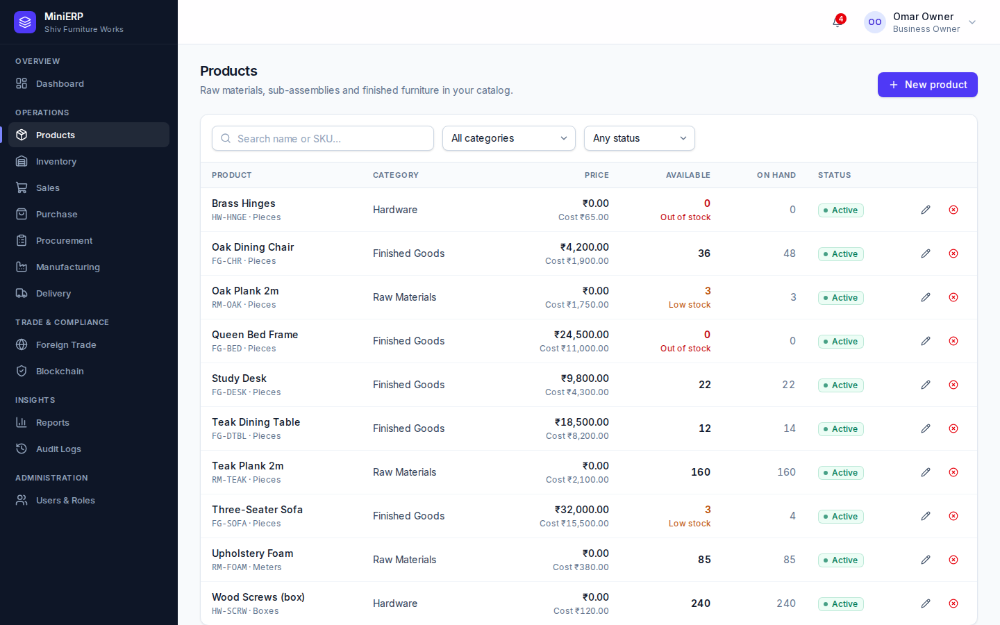
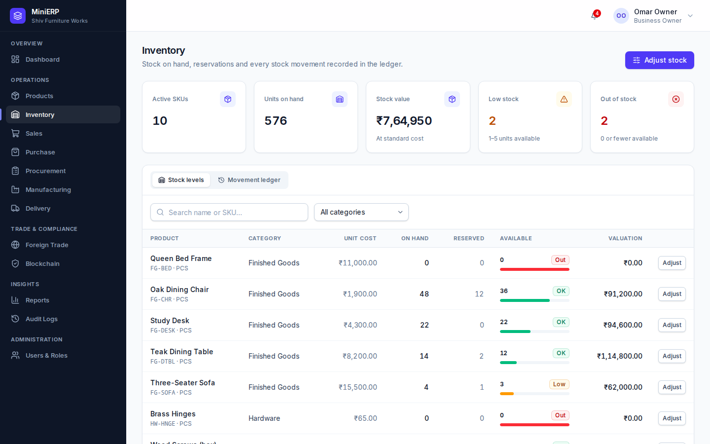
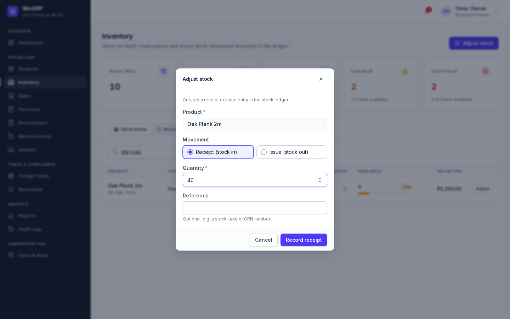
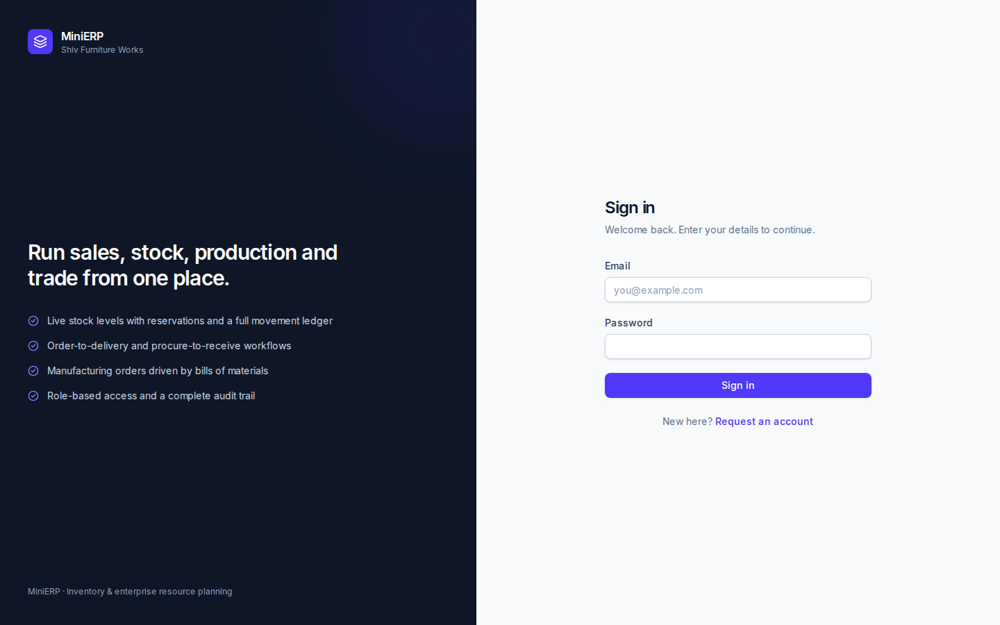
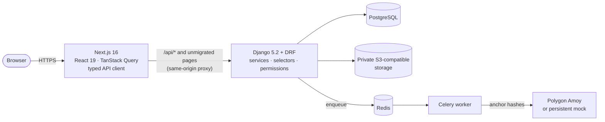

<div align="center">

# MiniERP

**A production-minded ERP for a furniture manufacturer, built with Django REST Framework and Next.js.**

Catalogue · inventory ledger · sales → delivery · purchasing · auto-procurement ·
manufacturing · foreign trade with tamper-evident documents · reports · audit trail

[](https://github.com/JarshinJS/minierp/actions/workflows/ci.yml)




</div>

## Contents

- [What it does](#what-it-does)
- [Engineering highlights](#engineering-highlights)
- [Architecture](#architecture)
- [Run it locally](#run-it-locally)
- [Testing](#testing)
- [Project structure](#project-structure)
- [Documentation](#documentation)
- [Status and roadmap](#status-and-roadmap)
- [License](#license)

## What it does

MiniERP runs the operations of a small furniture manufacturer, Shiv Furniture Works,
from catalogue to shipped export order. Ten roles each see only their part of it.

| Area | Capabilities |
|---|---|
| **Catalogue & inventory** | Products with cost/selling prices and units; an append-only stock ledger (receipts, issues, reservations, releases); low/out-of-stock tracking; manual adjustments for authorised roles |
| **Sales → delivery** | Orders reserve stock on confirmation; delivery notes go pending → dispatched (stock issued) → delivered; partial deliveries; no double allocation |
| **Purchasing & procurement** | Vendors and purchase orders with partial receipts; shortages automatically raise procurement triggers that draft a purchase order or a manufacturing order |
| **Manufacturing** | Bills of materials, work centres, manufacturing orders and work orders with component consumption |
| **Foreign trade** | Export/import orders through shipping and customs, invoices, trade partners, and versioned documents anchored by SHA-256 hash on a blockchain so tampering is detectable |
| **Oversight** | Role-filtered dashboard, CSV/JSON reports, a company-wide audit trail, account approval workflow |

<table>
  <tr>
    <td width="50%"></td>
    <td width="50%"></td>
  </tr>
  <tr>
    <td align="center"><sub>Catalogue: filters live in the URL</sub></td>
    <td align="center"><sub>Inventory: stock KPIs double as filters</sub></td>
  </tr>
  <tr>
    <td width="50%"></td>
    <td width="50%"></td>
  </tr>
  <tr>
    <td align="center"><sub>Every stock change is a ledger entry</sub></td>
    <td align="center"><sub>Session auth with CSRF; pending accounts are told why</sub></td>
  </tr>
</table>

## Engineering highlights

These are the parts worth reading in the code.

- **Live migration from Django templates to Next.js, with no big-bang rewrite.**
  Next.js serves rebuilt pages and proxies everything else to Django on the same
  origin, so one session works across both and each module moves independently.
  The E2E suite proves the two halves work together.
  → [ADR 0001](docs/adr/0001-strangler-fig-migration.md)
- **Defence in depth for access control.** One role/capability map drives the
  sidebar, the Django pages and all 146 API operations, enforced by middleware,
  permission classes and services. A regression test holds an *independent* copy of
  the role × endpoint matrix and fails if code and policy drift apart.
  → [Security model](docs/architecture.md#security-model)
- **Stock that can't be oversold.** One function changes quantities, using
  conditional `UPDATE … WHERE on_hand >= qty` statements; every movement is an
  immutable ledger row; delivery allocation locks the order row.
  → [Backend structure](docs/architecture.md#backend-structure)
- **Tamper-evident documents done properly.** Hashes are anchored by a Celery task
  with nonce management, retries with backoff and a database-backed mock chain, so
  verification is correct across processes and restarts. Uploads pass magic-byte,
  macro and size checks, are stored privately, and are downloaded through signed,
  expiring, user-bound links.
  → [ADR 0004](docs/adr/0004-blockchain-anchoring.md)
- **Session auth without JWT pitfalls.** `HttpOnly` first-party cookies, CSRF on
  every write (including login), login rate limits per IP and per e-mail, an approval
  workflow for self-registered accounts, and an open-redirect-proof `?next=`.
  → [ADR 0002](docs/adr/0002-session-auth-over-jwt.md)
- **Typed end to end.** drf-spectacular publishes an OpenAPI 3 schema; the frontend's
  API client is generated from it, and CI fails if the committed schema is stale.
- **Tested like a product.** 435 backend tests and 35 Playwright journeys run
  against real servers and a disposable seeded database: per-role permissions
  checked in the UI *and* the API, WCAG 2.1 AA checks with axe-core, and a phone
  viewport. Its first run caught real bugs.
  → [Testing](docs/testing.md)

## Architecture



Each Django app follows the same layering: views and serializers handle HTTP,
`services.py` owns every state change and transaction, `selectors.py` owns read
queries. The full picture, with routing, auth, domain model, workflows and the
permission matrix, is in **[docs/architecture.md](docs/architecture.md)**.

| | |
|---|---|
| **Frontend** | Next.js 16 (App Router) · React 19 · TypeScript (strict) · Tailwind CSS 4 · TanStack Query · openapi-fetch · lucide-react |
| **Backend** | Python 3.13 · Django 5.2 · Django REST Framework · drf-spectacular · Celery · Redis · web3.py |
| **Data** | PostgreSQL (SQLite for local work and tests) · S3-compatible private object storage |
| **Quality** | pytest · Playwright · axe-core · ESLint · GitHub Actions |

## Run it locally

Requirements: Python 3.13, Node.js 20.9+.

```bash
git clone https://github.com/JarshinJS/minierp.git && cd minierp

# Backend
python -m venv .venv && source .venv/bin/activate
pip install -r backend/requirements-dev.txt
cp backend/.env.example backend/.env           # then set SECRET_KEY
cd backend
python manage.py migrate
python manage.py seed_demo                      # demo users, catalogue, stock, orders
npm ci && npm run build:css                     # Tailwind CSS for the remaining Django pages
python manage.py runserver                      # http://localhost:8000

# Frontend (second terminal)
cd frontend
cp .env.example .env.local                      # BACKEND_URL=http://localhost:8000
npm install
npm run dev                                     # http://localhost:3000  ← open this
```

Sign in at **http://localhost:3000** with any demo account (password `Demo-pass-2026!`):

| Role | E-mail | Sees |
|---|---|---|
| Admin | `admin@demo.minierp.dev` | Everything, including user approval |
| Business Owner | `owner@demo.minierp.dev` | All modules |
| Sales User | `sales@demo.minierp.dev` | Sales, deliveries, read-only catalogue |
| Inventory Manager | `inventory@demo.minierp.dev` | Inventory, catalogue, procurement, deliveries |
| Accountant | `accountant@demo.minierp.dev` | Dashboard and reports |
| Trade Manager | `trade@demo.minierp.dev` | Foreign trade and blockchain documents |

`pending@demo.minierp.dev` shows the approval workflow. Signup codes are printed to
the Django console in development. Full instructions: [setup guide](docs/setup_guide.md).

## Testing

```bash
cd backend && python -m pytest          # 435 tests: rules, workflows, permissions, security
cd frontend && npm test                  # unit tests
cd frontend && npm run e2e               # 35 Playwright journeys (starts both servers itself)
```

| | |
|---|---|
| **Backend** | Business rules and workflows, the role × endpoint permission matrix, document security, blockchain correctness under concurrency, signup and redirect hardening |
| **End-to-end** | Sign-in, deep links, open-redirect guard, signup → e-mailed code → admin approval, per-role navigation and API enforcement, products, inventory and the ledger, procure-on-demand, dashboard, Django pages through the proxy, accessibility, phone layout |
| **CI** | Backend tests on SQLite **and** PostgreSQL, migration check · OpenAPI drift check · lint, types, unit tests, production build · Playwright with traces, videos and HTML report as artifacts · read-only permissions, no secrets, no deploy steps |

More detail on how the suite stays isolated and deterministic: [docs/testing.md](docs/testing.md).

## Project structure

```
minierp/
├── backend/                      Django project (API + remaining server-rendered pages)
│   ├── apps/                     14 business apps, each: models · services · selectors · api · tests
│   │   ├── accounts/             users, roles, approval workflow, permission map
│   │   ├── inventory/            stock ledger and adjustments
│   │   ├── sales/ delivery/      order → reservation → delivery
│   │   ├── purchase/ procurement/ manufacturing/
│   │   ├── foreign_trade/        export/import, documents, invoices
│   │   ├── blockchain/           hashing, anchoring tasks, verification
│   │   └── dashboard/ reports/ audit_logs/ …
│   ├── config/                   settings (base · dev · test · e2e · prod), URLs, /api/ router
│   └── core/                     shared exceptions, API handler, middleware, seed_demo
├── frontend/                     Next.js app
│   ├── src/app/                  (auth) and (app) route groups
│   ├── src/lib/api/              typed client + generated OpenAPI types
│   └── e2e/                      Playwright suite
├── docs/                         architecture, ADRs, testing, API, setup
└── .github/workflows/ci.yml
```

## Documentation

| | |
|---|---|
| [Architecture](docs/architecture.md) | System context, request routing, layering, auth flow, domain model, workflows, security model and permission matrix, with diagrams |
| [Decision records](docs/adr/) | Why: strangler migration, sessions over JWT, service layer, blockchain anchoring, E2E strategy |
| [Testing](docs/testing.md) | Test pyramid, E2E isolation, coverage by spec, bugs the suite found |
| [API](docs/api.md) | Conventions (auth, errors, pagination) and every endpoint; live schema at `/api/docs/` |
| [Setup guide](docs/setup_guide.md) | Local development in detail |
| [Modules](docs/modules.md) | What each Django app is responsible for |

## Status and roadmap

**The backend API is complete for all 14 modules.** The UI is mid-migration
([ADR 0001](docs/adr/0001-strangler-fig-migration.md)):

| Done in Next.js | Still Django pages (proxied, fully working) |
|---|---|
| Sign-in, signup + verification, Dashboard, Products, Inventory | Sales, Purchase, Procurement, Manufacturing, Delivery, Foreign Trade, Blockchain, Reports, Audit logs, Users & roles |

Next up: Sales and Delivery in Next.js (the order-to-delivery journey end to end in
Playwright), then removing the Django templates and the proxy fallback, so Django is
API-only.

## License

MiniERP is licensed under the [MIT License](LICENSE). Third-party dependencies remain under
their own licenses.
