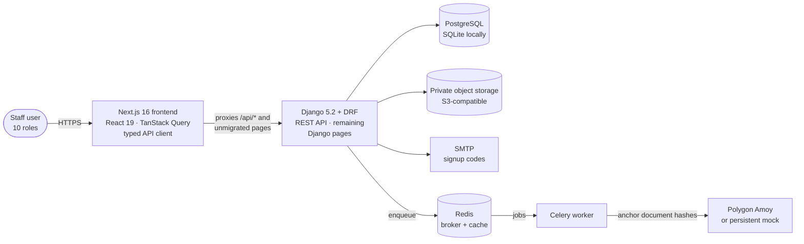
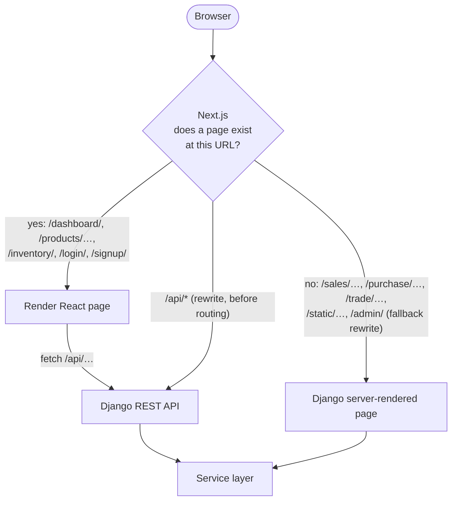
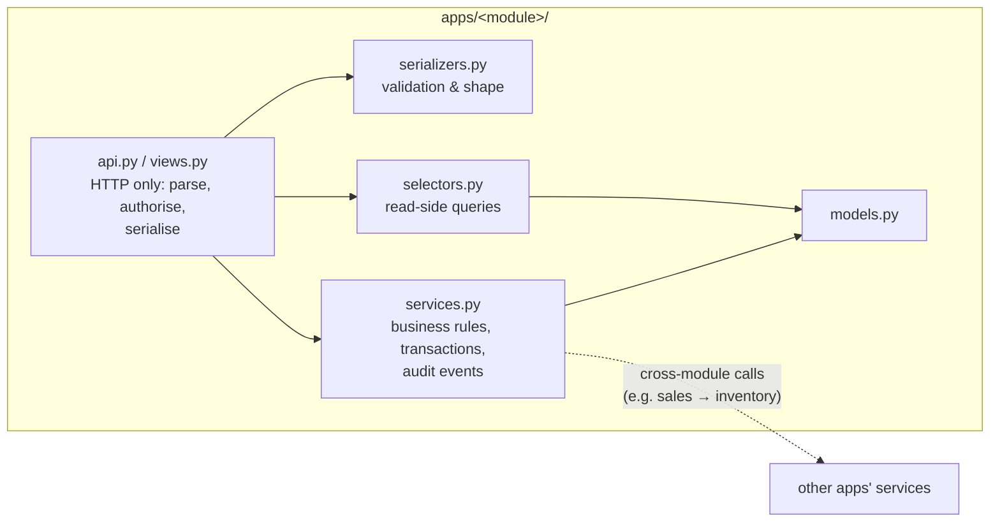
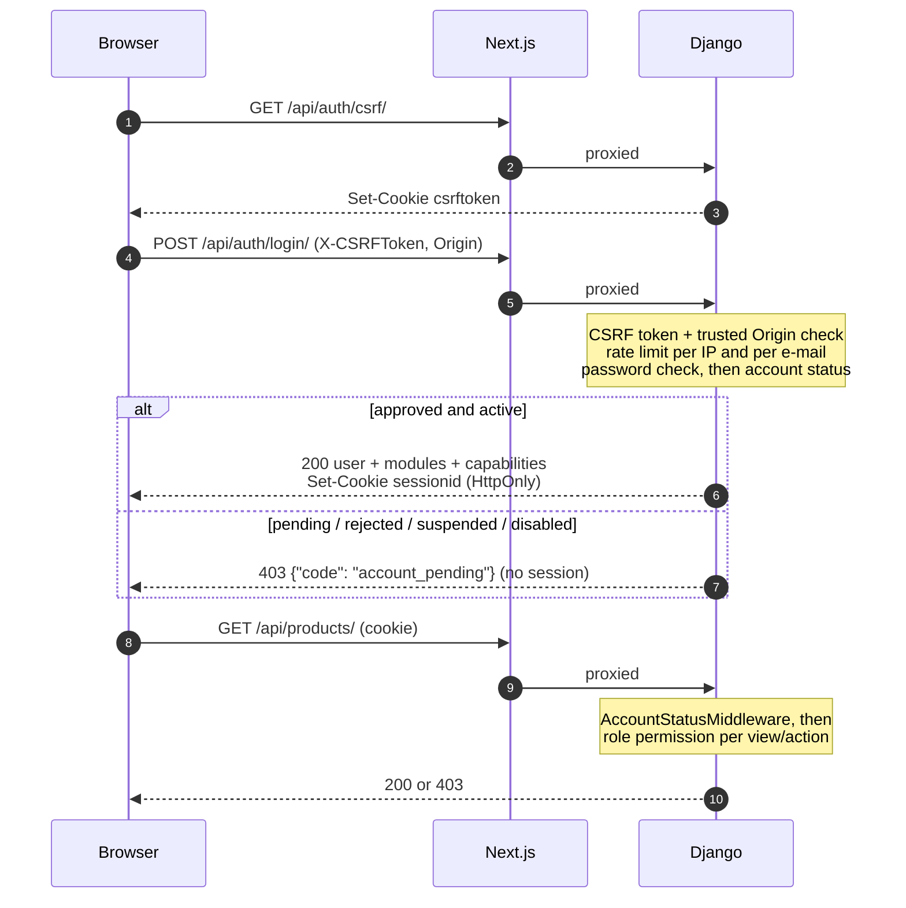
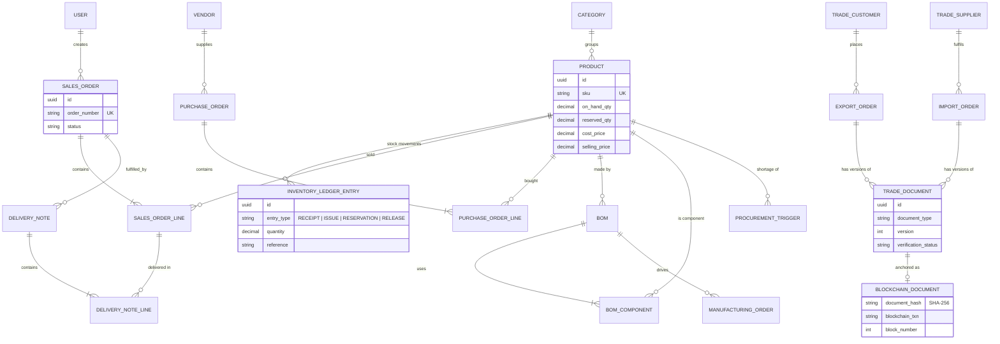
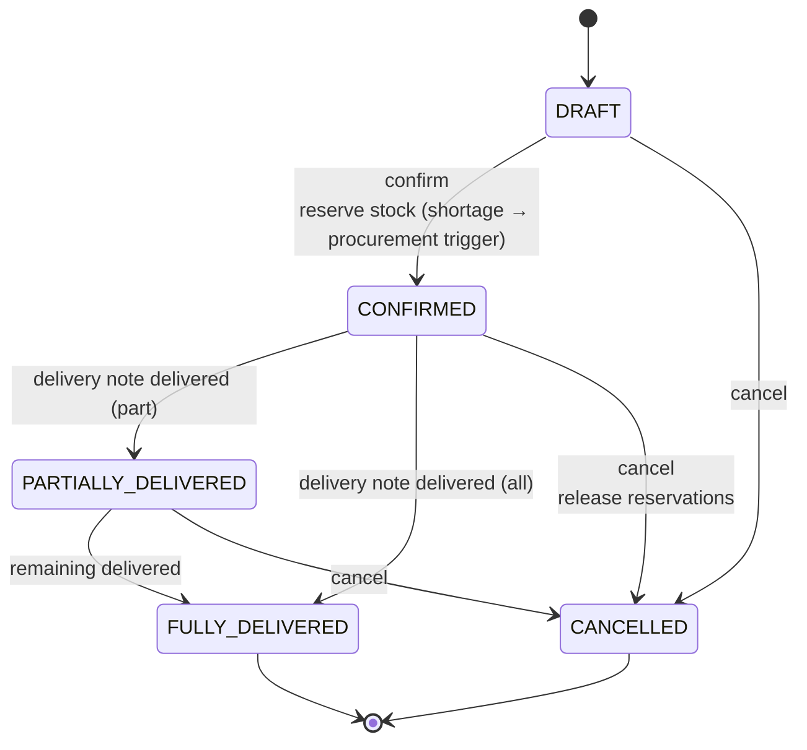
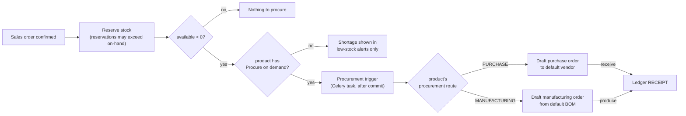
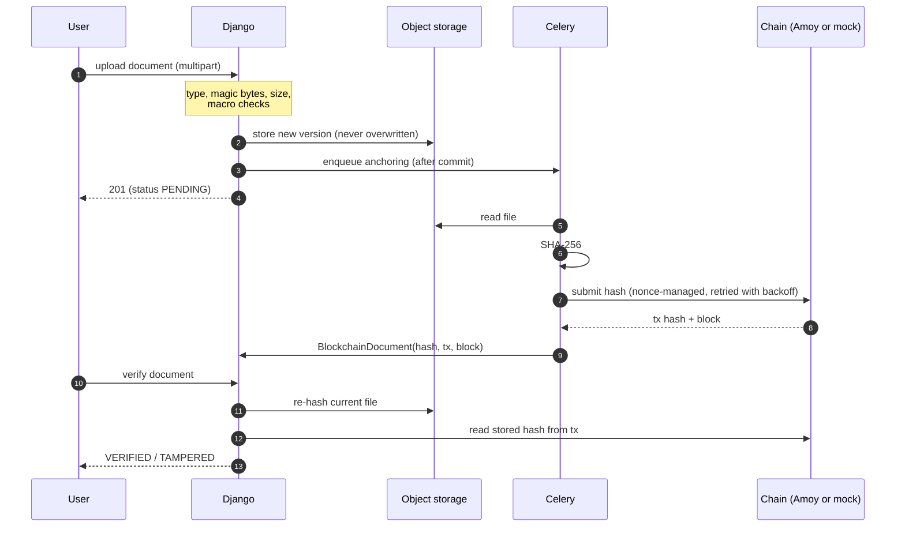

# Architecture

MiniERP is a modular ERP for a furniture manufacturer: catalogue, inventory, sales,
purchasing, procurement, manufacturing, delivery, foreign trade with tamper-evident
documents, reporting and a full audit trail. It is a **Django REST API** with a
**Next.js frontend**, in the middle of a deliberate, module-by-module migration away
from server-rendered Django pages.

- [System context](#system-context)
- [Request routing: the strangler migration](#request-routing-the-strangler-migration)
- [Backend structure](#backend-structure)
- [Frontend structure](#frontend-structure)
- [Authentication and CSRF](#authentication-and-csrf)
- [Domain model](#domain-model)
- [Business workflows](#business-workflows)
- [Tamper-evident trade documents](#tamper-evident-trade-documents)
- [Security model](#security-model) (accounts, enforcement, permission matrix, documents, redirects)
- Decisions behind all of this: [Architecture Decision Records](adr/)

## System context



The worker uses the same database and storage bucket as the web process.

| Layer | Technology | Why |
|---|---|---|
| UI | Next.js 16 (App Router), React 19, Tailwind 4 | Typed, component-based UI; one design system ported from the Django pages |
| Data fetching | TanStack Query + `openapi-fetch` | Caching, retries, and request/response types generated from the API schema |
| API | Django 5.2, Django REST Framework, drf-spectacular | Mature ORM and auth; OpenAPI 3 schema is the contract between the two apps |
| Jobs | Celery + Redis | Blockchain submissions take up to 120 s and must not block a request |
| Data | PostgreSQL in production, SQLite for local work and tests | |
| Files | Private S3-compatible bucket, signed short-lived download links | Trade documents are confidential |
| Tests | pytest (435), Node test runner, Playwright + axe-core (35 E2E) | See [testing.md](testing.md) |

## Request routing: the strangler migration

The browser only ever talks to the Next.js app. Next.js serves the pages that have
been rebuilt and **proxies everything else to Django on the same origin**, so a single
session cookie works for both and modules can move over one at a time
([ADR 0001](adr/0001-strangler-fig-migration.md)).



Both paths end in the same service layer, so a business rule behaves identically
whether it is reached from a React page, a Django page or the API. When a module is
migrated, its Django templates and HTML views are deleted, but its URL names stay
registered (pointing at `core.views.FrontendPageView`) so the remaining Django pages
can keep linking to it.

| Module | UI |
|---|---|
| Sign-in, signup + e-mail verification, Dashboard, Products, Inventory | Next.js |
| Sales, Purchase, Procurement, Manufacturing, Delivery, Foreign Trade, Blockchain, Reports, Audit logs, Users | Django (proxied), API complete |

## Backend structure

Each business area is a Django app under `backend/apps/` with the same internal
layering ([ADR 0003](adr/0003-service-layer.md)):



- **Views never write to models directly.** Every state change goes through a
  service function that validates the transition, runs in a transaction and records
  an audit event. Business-rule violations raise `DomainError` / `WorkflowError`,
  which a single DRF exception handler turns into `400 {"detail": …}`.
- **Stock can't be oversold.** `inventory.services.post_ledger_entry` is the only code
  that changes on-hand/reserved quantities, using conditional `UPDATE … WHERE
  on_hand >= qty` with `F()` expressions, so concurrent issues can't drive stock
  negative. Every movement is a row in an append-only ledger.
- **One permission map.** `apps/accounts/permissions.py` defines which roles see which
  module and who holds which write capability; the sidebar, the HTML views and every
  API endpoint derive from it (see [Security model](#security-model)).
- **API contract.** drf-spectacular generates `frontend/openapi.yaml`; CI fails if the
  committed file differs from what the code produces.

## Frontend structure

```
frontend/src/
├── app/
│   ├── (auth)/        login, signup, signup/verify       (public)
│   └── (app)/         dashboard, products, inventory     (behind AppShell)
├── components/        app-shell (sidebar, alerts, user menu), ui kit, bar chart
└── lib/
    ├── api/           openapi-fetch client + generated schema.d.ts
    ├── auth.ts        useMe / useLogin / useLogout, can(), canAccess()
    ├── nav.ts         sidebar definition (next: true = rebuilt page)
    ├── safe-redirect  ?next= validation
    └── url-state.ts   list filters kept in the query string
```

- All data comes from the API through one typed client; a schema change that breaks
  the frontend fails `tsc`, not production.
- List filters, tabs and pagination live in the URL, so views are shareable and the
  back button works.
- The UI hides what a role can't do (from `modules`/`capabilities` in `/api/auth/me/`),
  but every check is enforced again by the API. The E2E suite tests both.

## Authentication and CSRF

Session cookies, not JWTs ([ADR 0002](adr/0002-session-auth-over-jwt.md)). Because the
browser reaches the API through the Next.js origin, the cookie is first-party,
`HttpOnly`, `Secure`, `SameSite=Lax`, and no token is ever readable by JavaScript.



## Domain model

The core entities (38 models in total; audit and reference tables omitted):



## Business workflows

Every transition below is a service function that refuses illegal moves with a
`WorkflowError`. Side effects on stock happen inside the same transaction.

**Order to delivery**



A delivery note goes `PENDING → DISPATCHED` (stock issued) `→ DELIVERED`
(order quantities updated). Quantities already on open notes can't be allocated
twice, and the order row is locked while a note is created.

**Shortage to replenishment**



Export orders move `DRAFT → CONFIRMED → SHIPPED → DELIVERED`; import orders move
`DRAFT → CONFIRMED → IN_TRANSIT → CUSTOMS → RECEIVED`. Both can be cancelled before
completion. Creation, confirmation, shipping/transit, delivery, customs clearance
and invoicing each record a blockchain audit event (`apps/foreign_trade/workflows.py`).

## Tamper-evident trade documents



The mock chain used in development and tests is **persistent** (database-backed), so
verification gives the same answer across processes and restarts
([ADR 0004](adr/0004-blockchain-anchoring.md)).

## Security model

### Accounts and approval

Every account has an **account status** (`User.account_status`), separate from its role:

| Status | Meaning | Can sign in / use the ERP |
|---|---|---|
| `PENDING` | Self-registered, waiting for an administrator | No. Login answers `403 {"code": "account_pending"}` |
| `APPROVED` | Approved, with a role chosen by the approver | Yes (if `is_active`) |
| `REJECTED` | Request refused | No (`account_rejected`) |
| `SUSPENDED` | Temporarily blocked | No (`account_suspended`); existing sessions end on the next request |
| `is_active = False` | Disabled (independent of status) | No (`account_disabled`) |

Signup (email OTP) only ever creates `PENDING` accounts; the request can't set a role,
status or staff flag. An Admin or Business Owner approves the account **and picks its
role** (`POST /api/users/<id>/approve/ {"role": ...}` or the Users & roles page).
Status codes are only revealed after a correct password.

Rules (enforced in `apps/accounts/services.py`, so every caller gets them):
* only approved Admins / Business Owners manage accounts, and never their own;
* only an **Admin** may act on Admin / Business Owner accounts or grant those roles;
* the last active Admin can't be deactivated or demoted.

### How access is enforced

Three independent layers, all on the backend (the frontend only hides controls):

1. `core.middleware.AccountStatusMiddleware`: any authenticated session of a
   non-approved or inactive account is logged out and refused (JSON `403` with a
   `code` for `/api/`, plain `403` otherwise), before any view runs.
2. Permission classes: `DRFRolePermission` (role lists per view/action),
   `IsApprovedUser`, and `RoleRequiredMixin` for the remaining Django pages. All of
   them require an approved account, so a missing check in one layer is caught by another.
3. Service-level checks for privileged operations (account management).

Roles come from one place, `apps/accounts/permissions.py`: `MODULE_ACCESS` (which
modules a role can *see*) and `CAPABILITY_ROLES` (narrower *write* actions).
`GET /api/auth/me/` returns `modules` and `capabilities` so the UI can hide what the
user can't do. The regression test `core/tests/test_permission_matrix.py` holds an
independent copy of the matrix below and fails if code and policy diverge.

MiniERP is single-company: there is no organisation/tenant model, so every approved
user with a role sees that module's records company-wide. There is no per-user record
ownership in the current modules.

### Role and permission matrix

R = read, W = create/update/workflow actions, — = no access. Admin has every permission.
(BO = Business Owner, Inv Mgr = Inventory Manager, Doc Off = Documentation Officer.)

| Area (API) | BO | Sales | Purchase | Mfg | Inv Mgr | Accountant | Trade Mgr | Doc Off | Finance Mgr | Auditor |
|---|---|---|---|---|---|---|---|---|---|---|
| Users & approval (`/api/users/`) | RW¹ | — | — | — | — | — | — | — | — | — |
| Products & categories | RW | R | RW | — | RW | — | — | — | — | — |
| Inventory stock & ledger | R | — | — | R | R | — | — | — | — | — |
| Manual stock adjustment | W | — | — | — | W | — | — | — | — | — |
| Sales orders | RW | RW | — | — | — | — | — | — | — | — |
| Deliveries (create) | RW | RW | — | — | RW | — | — | — | — | — |
| Delivery dispatch | W | — | — | — | W | — | — | — | — | — |
| Vendors & purchase orders | RW | — | RW | — | — | — | — | — | — | — |
| Procurement triggers | R | — | R | — | R | — | — | — | — | — |
| Manufacturing (BOMs, MOs, work centres, work orders) | RW | — | — | RW | — | — | — | — | — | — |
| Export / import orders | RW | — | — | — | — | — | RW | R | R | R |
| Export invoices | W | — | — | — | — | — | W | — | W | — |
| Trade documents: list / download / verify | R | — | — | — | — | — | R | R | — | R |
| Trade documents: upload | W | — | — | — | — | — | W | W | — | — |
| Shipments | R | — | — | — | — | — | R | R | — | R |
| Trade customers & suppliers | RW | — | — | — | — | — | RW | — | — | — |
| Countries / currencies / incoterms | R | — | — | — | — | — | R | R | R | R |
| Blockchain documents | R | — | — | — | — | — | R | R | — | R |
| Blockchain audit log | R | — | — | — | — | — | R | — | — | R |
| Reports & CSV exports | R | — | — | — | — | R | — | — | — | — |
| Audit trail (`/api/audit-logs/`) | R | — | — | — | — | — | — | — | — | R |
| Dashboard summary (company-wide KPIs) | R | — | — | — | — | — | — | — | — | — |
| Dashboard overview / analytics / alerts | R² | R² | R² | R² | R² | R² | R² | R² | R² | R² |
| Voice assistant | same rules as the action it performs | | | | | | | | | |

¹ Business Owners manage regular accounts only; Admin/Business Owner accounts and
roles are Admin-only. ² Content is filtered to the modules the role can access.
Anonymous, pending, rejected, suspended and disabled accounts get nothing anywhere.

### Trade documents

* Stored in **private object storage** (Supabase Storage via its S3 API) under random
  keys (`trade_documents/<type>/<uuid>.<ext>`). The bucket has no public access and
  the app never hands out storage URLs or credentials.
* The `file` field of a document is a link to
  `GET /api/trade/documents/<id>/download/?token=…`. The token is signed, bound to
  that user and that document, and expires after `DOCUMENT_DOWNLOAD_URL_TTL`
  (300 s). The download also requires an approved session with a document-read role,
  and is served as an attachment with `nosniff`, `no-store` and a sandbox CSP.
* Uploads are checked for extension, real file type (magic bytes), declared MIME type,
  size (≤ 10 MB), filename safety, and Office macros.
* Files are never overwritten or deleted by the app: each upload is a new version, and
  the blockchain hash of every version stays verifiable. The web service and the
  Celery worker read the same bucket.

### Redirects

Post-login navigation (`?next=`) is validated by `frontend/src/lib/safe-redirect.ts`:
same-site relative paths only. External URLs, `//host`, backslashes, whitespace or
control characters, encoded separators and schemes such as `javascript:` all fall
back to `/dashboard/`. The backend never redirects to a user-supplied URL.
